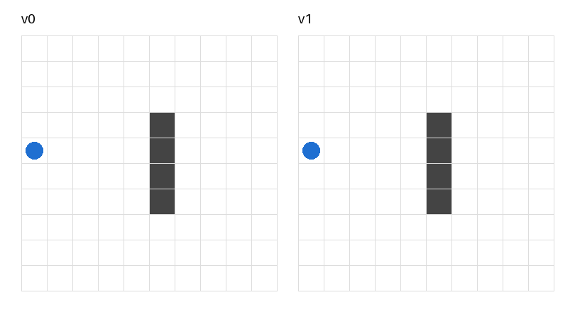

# weight-space-pilot

A pilot experiment inspired by *Weight-Space Programming* (Takehi, Teoh, Zhang and Khattab, MIT CSAIL, 2026), in which a frontier language model reads the weights of a neural network as text and rewrites them directly, without an optimizer.



## Question

Can a mid-sized open model, running locally on a laptop, improve the behaviour of a tiny neural network by editing its weights directly, with no gradient descent, no backpropagation and no reinforcement learning?

This is an experiment with a single attempt. It does not show whether the method works. It is a first qualitative look at how a 14B model handles the task.

## Setup

**Environment** (`ambiente.py`). A 10×10 grid. The agent starts in column 0, moves one column to the right at every step and chooses an action (0 up, 1 straight, 2 down). A wall occupies column 5, rows 3 to 6. The score is the number of start rows, out of 10, from which the agent reaches column 9 without hitting the wall.

**Network** (`rete.py`). PyTorch, 4 inputs, 4 tanh hidden units, 3 action scores, argmax. 35 parameters in total. The inputs are the agent's row, the distance to the wall and the position of the wall's top and bottom relative to the agent, all divided by 10. Weights are initialised with `torch.manual_seed(0)` and the network always runs under `torch.no_grad()`.

**Editor model** (`llm.py`). Qwen3 14B (`qwen3:14b`, Q4_K_M) through Ollama on a MacBook Air M4 with 16 GB of RAM. Temperature 0, seed 42, context 12,288 tokens, thinking enabled, at most 8,000 generated tokens.

**Prompt** (`versioni/prompt_v0.txt`). The game rules, the network equations, the current weights as JSON (3 decimals), the outcome and path from each of the 10 start rows, the current score and the task. The model is told not to write code and to reply only with the full set of new weights.

**Loop** (`esperimento.py`). Load version `n`, score it, build the prompt, ask the model, save prompt, reasoning and answer to a log, load the proposed weights as version `n+1` and score them. If the answer does not contain a complete JSON object (because the reasoning used up the token budget), a second call sends back the prompt plus the model's own reasoning and asks only for the JSON, with thinking disabled. This happened in the run reported here.

The only source of change is the model's proposal. The environment, the rules and the scoring are fixed.

## Results

| Version | Score |
|---|---|
| v0 (random weights) | 6/10 |
| v1 (weights proposed by Qwen3 14B) | 9/10 |

Qwen changed 5 of the 35 parameters. `ablazione.py` applies each change alone to v0 and removes each change alone from v1.

| Parameter | v0 | v1 | Only this change on v0 | v1 without this change |
|---|---|---|---|---|
| `0.weight[1][3]` | 0.396 | 0.5 | 6 | 9 |
| `2.weight[0][1]` (into "up") | 0.415 | 0.5 | 6 | 8 |
| `2.weight[2][0]` (into "down") | -0.315 | 0.2 | 6 | 9 |
| `2.bias[0]` ("up" bias) | -0.324 | -0.2 | 8 | 6 |
| `2.bias[2]` ("down" bias) | -0.349 | -0.2 | 6 | 9 |

Almost all of the gain comes from the bias of the "up" action, which pushes the agent upwards from every position. With v1 the agent climbs to row 0 from rows 1 to 5 and passes above the wall. From row 6, where moving down would have been enough, it still crashes. The change the model reasoned about most (`0.weight[1][3]`) has no effect on the score.

## Limitations

One network, one environment, one attempt, one model. There is no baseline of random edits to the same number of parameters, so it is not possible to say whether the gain exceeds what chance would give. The comparison with a frontier model (Claude Opus 5.5) on the same prompt is planned but not done.

## Run it

Tested with Python 3.14, PyTorch 2.11 and Ollama 0.35 on a MacBook Air M4 (16 GB). Variable names and printed messages are in Italian.

```
pip install torch
ollama pull qwen3:14b
python3 ablazione.py        # reproduces the scores and the ablation table from the saved weights
python3 esperimento.py 0    # reruns the edit round v0 -> v1 (about 20 minutes, overwrites versioni/v1.json and the log)
```

`versioni/v0.json` is the network produced by `torch.manual_seed(0)`. Even with temperature 0 and a fixed seed, a different Ollama version or different hardware may produce a different answer from the model.

## Reference

Takehi, Teoh, Zhang and Khattab (2026). *Weight-Space Programming*. Blog post, MIT CSAIL, 2 November 2026. https://rikiyat.github.io/blog/weight-space-programming/
